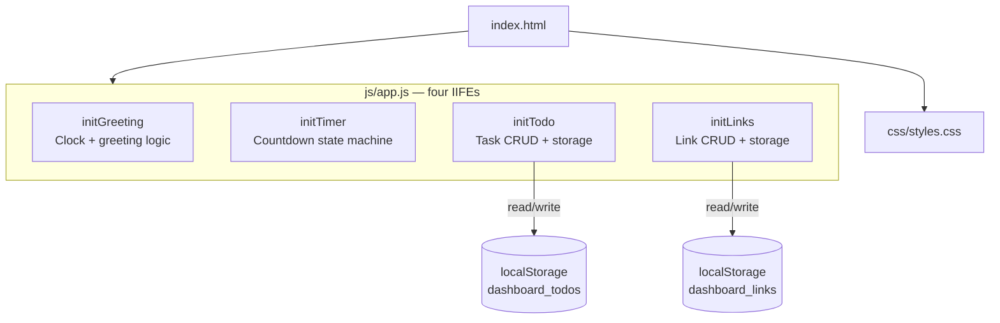
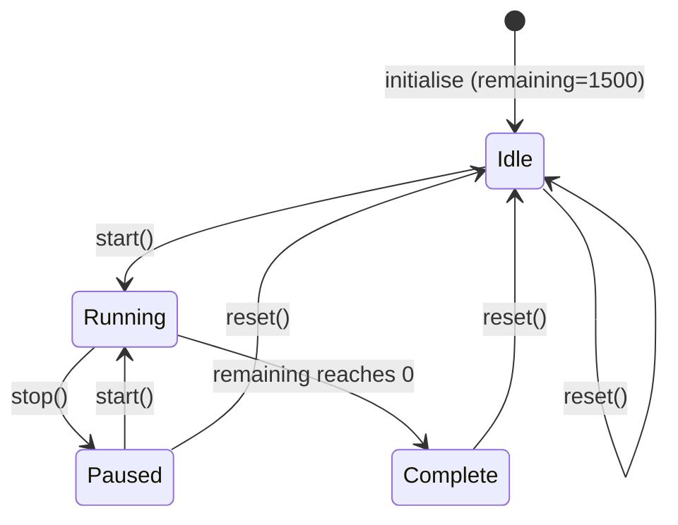

# Design Document — Personal Dashboard

## Overview

The Personal Dashboard is a self-contained, client-side single-page application (SPA) delivered as a single `index.html` file. It targets anyone who wants a lightweight browser start-page or a browser-extension new-tab page, with zero server dependency, zero npm packages, and zero build tooling.

The application provides four widgets:

| Widget | Purpose |
|---|---|
| Greeting | Live clock, date, and time-of-day greeting |
| Focus Timer | 25-minute Pomodoro-style countdown |
| To-Do List | Session and persistent task tracking |
| Quick Links | Saved bookmark panel |

All persistence is handled entirely through the browser's `localStorage` API. The entire codebase lives in three files: `index.html`, `css/styles.css`, and `js/app.js`.

### Design Goals

1. **No external dependencies** — every byte ships with the page.
2. **Pure-function logic wherever possible** — makes the non-DOM code independently testable.
3. **Fail gracefully** — every localStorage operation is wrapped; a storage failure degrades cleanly without crashing other widgets.
4. **Accessible by default** — ARIA labels, visible focus rings, contrast ratios ≥ 4.5:1.

---

## Architecture

The application follows an **IIFE module pattern** — each widget is an immediately-invoked function expression that owns its own state and DOM references, with no globals shared between widgets. Communication between the widget and the DOM is direct; there is no virtual DOM, reactive framework, or event bus.



### Data Flow

```
User interaction
      │
      ▼
DOM event handler (in IIFE)
      │
      ├─► Pure logic function (validate / transform)
      │         │
      │         ▼
      │   Updated data array
      │         │
      │         ├─► Storage.save()  ──► localStorage.setItem()
      │         │
      │         └─► render()  ──► DOM mutation
      │
      └─► (on error) show inline error message
```

Each widget follows the same three-step cycle: **validate → persist → render**. The persist step is synchronous; if it throws, the widget catches the error, keeps the in-memory state, and surfaces an error message to the user.

---

## Components and Interfaces

### 1. Storage Module (inlined per widget)

Each widget embeds its own `loadX()` / `saveX()` pair rather than sharing a central storage object. This keeps each IIFE fully self-contained and prevents a storage error in one widget from propagating to another.

```js
// Pattern shared by both Todo and Links widgets
function loadItems() {
    try {
        return JSON.parse(localStorage.getItem(STORAGE_KEY)) ?? [];
    } catch {
        return [];   // malformed JSON → empty collection
    }
}

function saveItems(items) {
    // Throws on quota errors — callers must catch
    localStorage.setItem(STORAGE_KEY, JSON.stringify(items));
}
```

**Storage keys** (fixed, distinct):

| Widget | Key |
|---|---|
| Tasks | `dashboard_todos` |
| Links | `dashboard_links` |

### 2. Greeting Widget (`initGreeting`)

**Responsibilities:**
- Keep a live `HH:MM:SS` clock updated via `setInterval(update, 1000)`.
- Derive a time-of-day greeting from `new Date().getHours()`.
- Format the date line with weekday, month, day, and year via `toLocaleDateString`.

**Public surface:** none — fully self-contained IIFE.

**Key functions:**

```js
getGreeting(hour: number): string
// hour ∈ [5,11]  → "Good morning ☀️"
// hour ∈ [12,16] → "Good afternoon 🌤️"
// hour ∈ [17,20] → "Good evening 🌆"
// hour ∈ {21,22,23,0,1,2,3,4} → "Good night 🌙"

formatTime(date: Date): string
// returns "HH:MM:SS" string from a Date object
```

### 3. Focus Timer (`initTimer`)

**Responsibilities:**
- Maintain `remaining` (seconds) in local state.
- Manage `intervalId` for the `setInterval` countdown.
- Update button disabled states to reflect running / stopped / complete.
- Display `formatTime(remaining)` in MM:SS format.

**State machine:**



**Key functions:**

```js
formatTime(seconds: number): string
// seconds ∈ [0, 1500] → "MM:SS" (e.g. 90 → "01:30")

start(): void   // transitions Idle/Paused → Running
stop(): void    // transitions Running → Paused
reset(): void   // transitions any state → Idle
tick(): void    // called by setInterval; decrements remaining
```

### 4. Todo Manager (`initTodo`)

**Responsibilities:**
- CRUD operations on an in-memory task array that is always mirrored to localStorage.
- Inline editing via double-click.
- Validation: reject empty/whitespace labels and labels > 120 characters.
- Empty-state and error message display.

**Task data shape:**

```js
{
    id:   number,    // Date.now() at creation — insertion-order proxy
    text: string,    // trimmed label, 1–120 chars
    done: boolean    // completion state
}
```

**Key functions:**

```js
loadTasks(): Task[]
saveTasks(tasks: Task[]): void   // throws on quota error

addTask(text: string): void
deleteTask(id: number): void
toggleDone(id: number): void
commitEdit(id: number, newText: string): void
// trims newText; no-ops if empty or identical to original

renderTasks(): void   // full re-render from storage
showError(message: string): void
```

### 5. Links Manager (`initLinks`)

**Responsibilities:**
- CRUD operations on a link collection persisted to localStorage.
- URL normalisation: prepend `https://` if no protocol present.
- URL validation: reject strings that cannot be parsed by `new URL()` after normalisation.
- Favicon fetching from `{origin}/favicon.ico` with graceful `onerror` fallback.

**Link data shape:**

```js
{
    id:    number,   // Date.now() at creation
    label: string,   // 1–40 chars
    url:   string    // absolute URL, always starts with http(s)://
}
```

**Key functions:**

```js
loadLinks(): Link[]
saveLinks(links: Link[]): void   // throws on quota error

normalizeUrl(input: string): string
// prepends "https://" if no http(s):// prefix present

validateUrl(url: string): boolean
// returns true if new URL(url) does not throw

addLink(label: string, url: string): void
deleteLink(id: number): void
renderLinks(): void
```

---

## Data Models

### Task

```js
/**
 * @typedef {Object} Task
 * @property {number}  id    - Unix timestamp (ms) used as unique ID and sort key
 * @property {string}  text  - Task label, trimmed, 1–120 characters
 * @property {boolean} done  - true = completed, false = pending
 */
```

Stored as a JSON array under `localStorage['dashboard_todos']`:

```json
[
  { "id": 1718000000000, "text": "Review pull request", "done": false },
  { "id": 1718000001000, "text": "Write unit tests",   "done": true  }
]
```

Ordering is determined by array index, which reflects insertion order (new tasks are appended).

### Link

```js
/**
 * @typedef {Object} Link
 * @property {number} id    - Unix timestamp (ms) used as unique ID
 * @property {string} label - Display name, 1–40 characters
 * @property {string} url   - Absolute URL, always starts with http(s)://
 */
```

Stored as a JSON array under `localStorage['dashboard_links']`:

```json
[
  { "id": 1718000002000, "label": "GitHub",  "url": "https://github.com" },
  { "id": 1718000003000, "label": "MDN Docs","url": "https://developer.mozilla.org" }
]
```

### Storage Invariants

- Both keys always hold either a valid JSON array string or are absent (`null` from `getItem`).
- A missing key is treated as an empty array on load.
- Malformed JSON in one key does not affect the other key's load operation.
- IDs are `Date.now()` values — unique within a session for all practical purposes; no server-side ID generation is required.

---

## Correctness Properties

*A property is a characteristic or behavior that should hold true across all valid executions of a system — essentially, a formal statement about what the system should do. Properties serve as the bridge between human-readable specifications and machine-verifiable correctness guarantees.*

---

### Property 1: Greeting coverage — every hour maps to exactly one greeting

*For any* integer hour in [0, 23], `getGreeting(hour)` SHALL return exactly one of the four greeting strings ("Good morning", "Good afternoon", "Good evening", "Good night"), and the returned string SHALL match the boundary specified in requirements 1.3–1.6.

**Validates: Requirements 1.3, 1.4, 1.5, 1.6**

---

### Property 2: Timer format produces valid MM:SS strings

*For any* integer number of seconds in the range [0, 1500], `formatTime(seconds)` SHALL return a string that matches the regular expression `/^\d{2}:\d{2}$/`, where the minutes component is in [00, 25] and the seconds component is in [00, 59].

**Validates: Requirements 2.7**

---

### Property 3: Task addition round-trip

*For any* non-empty string of up to 120 non-whitespace-only characters, calling `addTask(text)` SHALL increase the length of the stored task array by exactly 1, and the new task SHALL be retrievable from `loadTasks()` with its text equal to `text.trim()` and `done` set to `false`.

**Validates: Requirements 3.2, 5.4, 8.1**

---

### Property 4: Whitespace task rejection

*For any* string composed entirely of whitespace characters (spaces, tabs, newlines), calling the add-task submit handler with that string as input SHALL leave the stored task array unchanged and SHALL NOT add a task to the list.

**Validates: Requirements 3.3**

---

### Property 5: Task completion toggle is an involution

*For any* task (done or pending), toggling its `done` state twice SHALL return the task to its original `done` value, and the updated state SHALL be persisted to `localStorage` after each toggle.

**Validates: Requirements 5.1**

---

### Property 6: Task deletion reduces list by exactly one

*For any* non-empty array of tasks and any task `t` in that array, calling `deleteTask(t.id)` SHALL produce a stored array of length `originalLength - 1` that contains no task with `id === t.id`, while all other tasks remain present with their original data.

**Validates: Requirements 5.3**

---

### Property 7: Task storage round-trip preserves full fidelity

*For any* array of tasks (arbitrary labels, done states, and ordering), calling `saveTasks(tasks)` followed by `loadTasks()` SHALL return an array that is deeply equal to the original — same length, same order, same `id`, `text`, and `done` values for every element.

**Validates: Requirements 5.4, 8.1, 8.2**

---

### Property 8: Malformed JSON returns empty collection without throwing

*For any* string that is not valid JSON, setting `localStorage['dashboard_todos']` or `localStorage['dashboard_links']` to that string and then calling `loadTasks()` or `loadLinks()` respectively SHALL return an empty array (`[]`) and SHALL NOT throw an exception, and the other collection's load SHALL be unaffected.

**Validates: Requirements 8.3**

---

### Property 9: URL normalisation always produces an https:// prefix

*For any* non-empty string that does not begin with `http://` or `https://`, calling `normalizeUrl(input)` SHALL return a string that begins with `"https://"` and whose suffix equals the original input string.

**Validates: Requirements 6.3**

---

### Property 10: Link addition round-trip

*For any* non-empty label (up to 40 chars) and valid URL, calling `addLink(label, url)` SHALL increase the length of the stored link array by exactly 1, and the new link SHALL be retrievable from `loadLinks()` with its label and normalised URL preserved.

**Validates: Requirements 6.2, 6.7, 6.8, 8.1**

---

### Property 11: Empty/whitespace link form rejection

*For any* form submission where the label or the URL field is empty or whitespace-only, the submit handler SHALL leave the stored link array unchanged and SHALL NOT add a link.

**Validates: Requirements 6.5**

---

### Property 12: Link deletion reduces collection by exactly one

*For any* non-empty array of links and any link `l` in that array, calling `deleteLink(l.id)` SHALL produce a stored array of length `originalLength - 1` that contains no link with `id === l.id`, while all remaining links retain their original data.

**Validates: Requirements 7.1**

---

## Error Handling

### localStorage Quota / Availability Errors

All writes to localStorage (`localStorage.setItem`) may throw a `DOMException` (e.g., `QuotaExceededError` in private-browsing mode or when storage is full). The handling strategy is consistent across both widgets:

```
try {
    saveItems(updatedCollection);
    render();
} catch (err) {
    showErrorMessage("Could not save — storage unavailable.");
    // In-memory state already updated; DOM reflects the change.
    // On next reload the change will be lost, but the current session
    // remains functional.
}
```

The in-memory state is never rolled back after a storage error. This is an intentional tradeoff: the user sees their change take effect immediately, with a warning that it will not survive a reload.

### Malformed JSON on Load

Both `loadTasks()` and `loadLinks()` wrap `JSON.parse` in a `try/catch` and return `[]` on any error. This prevents a corrupted storage entry from crashing the widget, and treats the situation identically to an empty collection.

### Invalid URL Submission

Before adding a link, the `Links_Manager` runs:

```js
function validateUrl(href) {
    try { new URL(href); return true; }
    catch { return false; }
}
```

If validation fails after `normalizeUrl` is applied, the form submission is rejected and an inline message is shown. The `links` array is not modified.

### Timer Edge Cases

- Calling `start()` when the timer is already running is a no-op (guarded by `if (intervalId) return`).
- Calling `reset()` always clears any active `intervalId` before restoring state, preventing multiple concurrent intervals.

### Empty / Whitespace Input Validation

Both the Todo and Links widgets trim input values before checking emptiness. Any string whose `.trim()` result is `""` is treated as invalid. The HTML `maxlength` attribute provides a first line of defence at the browser level; the JS validation layer enforces the same rules programmatically for completeness.

---

## Testing Strategy

This project is a Vanilla JS browser application with no build system. The recommended testing approach uses **[Vitest](https://vitest.dev/)** for the unit and property-based test runner (it can run in a Node environment without a browser), and **[fast-check](https://fast-check.io/)** as the property-based testing library.

Because the project has a no-external-dependencies constraint for the *production* code, test dependencies are development-only and are never bundled into `index.html`.

### Test Setup

The pure logic functions (`getGreeting`, `formatTime`, `normalizeUrl`, `validateUrl`, `loadTasks`, `saveTasks`, `loadLinks`, `saveLinks`, `addTask`, `deleteTask`, `toggleDone`, `commitEdit`, `addLink`, `deleteLink`) should be extracted from their IIFEs into a separate **`js/logic.js`** module that is imported only by the test suite (not by `index.html` directly). This keeps the production constraint intact while making the logic independently testable.

A lightweight `localStorage` mock (e.g., `vitest-localstorage-mock` or a hand-rolled Map-backed stub) provides deterministic storage behaviour in Node.

### Unit Tests

Unit tests cover specific examples, edge cases, and error conditions:

- Timer initialises to `"25:00"`, completes at `"00:00"` with correct button states.
- Empty-state messages render when collections are empty.
- Edit cancel (Escape) restores original label without touching localStorage.
- Storage error surfaces the correct inline error message.
- Link `target="_blank"` and `rel="noopener noreferrer"` are present on rendered anchors.
- Delete button calls `e.preventDefault()` before removing the link.
- Distinct, fixed localStorage keys for tasks and links.

### Property-Based Tests (fast-check, minimum 100 iterations each)

Each property-based test runs `fc.assert(fc.property(...))` with at least 100 generated examples. Each test is tagged with a comment referencing the design property it validates.

**Tag format:** `// Feature: personal-dashboard, Property {N}: {property_text}`

| Test | Arbitraries | Property verified | Design Ref |
|---|---|---|---|
| Greeting coverage | `fc.integer({min:0, max:23})` | All 24 hours map to the correct greeting string | Property 1 |
| Timer format | `fc.integer({min:0, max:1500})` | Output matches `/^\d{2}:\d{2}$/`, MM ∈ [0,25], SS ∈ [0,59] | Property 2 |
| Task add round-trip | `fc.string({minLength:1}).filter(s=>s.trim().length>0).map(s=>s.substring(0,120))` | List grows by 1; task recoverable from loadTasks() | Property 3 |
| Whitespace rejection | `fc.stringOf(fc.constantFrom(' ','\t','\n'))` | List unchanged after submit attempt | Property 4 |
| Toggle involution | `fc.record({id:fc.nat(), text:fc.string(), done:fc.boolean()})` | toggle(toggle(task)).done === task.done | Property 5 |
| Task deletion | `fc.array(taskArb, {minLength:1})` + random index | Length -1; deleted task absent; others intact | Property 6 |
| Task storage round-trip | `fc.array(taskArb)` | saveTasks then loadTasks produces deep-equal array | Property 7 |
| Malformed JSON resilience | `fc.string().filter(s=>{try{JSON.parse(s);return false}catch{return true}})` | loadTasks()/loadLinks() returns [] without throwing | Property 8 |
| URL normalisation | `fc.webUrl().map(u=>u.replace(/^https?:\/\//,''))` | Result starts with `"https://"` | Property 9 |
| Link add round-trip | `fc.record({label:fc.string({minLength:1,maxLength:40}), url:fc.webUrl()})` | Count +1; link in loadLinks() with correct data | Property 10 |
| Empty link rejection | `fc.record({label:fc.constantFrom('','  '), url:fc.webUrl()})` (and vice-versa) | Count unchanged | Property 11 |
| Link deletion | `fc.array(linkArb, {minLength:1})` + random index | Length -1; deleted link absent; others intact | Property 12 |

### Integration / Accessibility Tests

- **axe-core** automated accessibility audit: run against the rendered `index.html` in a headless browser (Playwright or Puppeteer) to catch contrast, label, and focus-indicator issues (Requirements 11.1–11.6).
- **Lighthouse** or equivalent performance audit for load-time requirements (Requirement 10.1).
- Manual cross-browser smoke tests in Chrome, Firefox, Edge, and Safari (Requirement 9.4).
